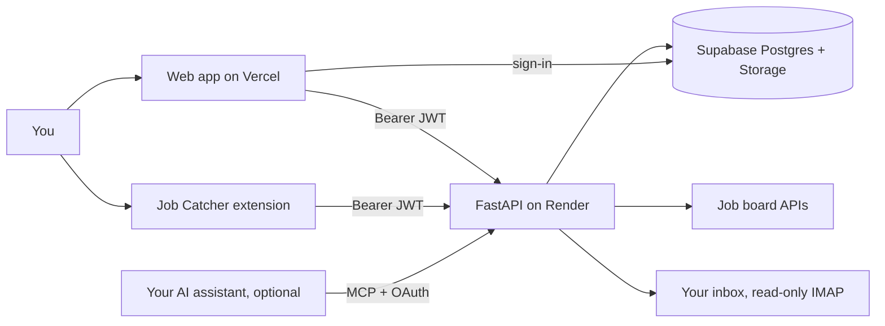

# Job Enhancer

**Every job in one place. Track everything. Apply faster.**

[](https://github.com/5Cl0ver/job_enhancer/actions/workflows/ci.yml)
[](LICENSE)

Job Enhancer is a job-search app plus a Chrome extension. It finds jobs, saves
them from any site, fills in application forms, and keeps every application up
to date from your email, so the busywork of applying takes minutes instead of
hours.

It works fully **without AI**. If you already use an AI assistant (Claude, or
any assistant that supports MCP connectors), you can plug it in and let it do
more, but nothing in the app depends on it.

> **Status:** live and in daily use by its developer and a few friends. Built in
> public, one spec at a time (see [`specs/`](specs/)).

---

## What it does

**Find jobs**
- One search across several job boards, with repeats merged automatically
- Saved searches that re-run every day and show new matches
- Add any job by pasting its link

**Keep track**
- A board with your own stages (Applied, Interview, Offer…), drag and drop,
  and follow-up reminders when things go quiet
- Collections (folders), filters, and a page per job with its notes, emails and
  documents
- Analytics: applications per week, response rate, interviews

**Email updates**
- Connect your inbox (Yahoo, Gmail, AOL, iCloud and others, read-only)
- Rejections, interview invites and other replies are matched to the right job
  and move its card for you, with every email kept on the job's page

**Job Catcher (Chrome extension)**
- Save a job from any site: LinkedIn, Indeed, company career pages, and more
- Autofill application forms (Workday, Greenhouse, Lever and most other sites)
  from your profile and résumé, only when you press the button
- It learns: fix an answer once and it's used on every site after that, and
  you can see and edit everything it remembers in the app
- It never presses Submit for you

**Résumés and cover letters**
- Keep a main résumé plus versions made for specific jobs, and pick which one
  goes with each job
- Cover letters work the same way, and Job Catcher attaches the right ones

**Optional: bring your own AI**
- A built-in [MCP connector](docs/mcp-connector.md) lets your own Claude read
  your jobs and profile and save work back into the app
- **Scout**: Claude searches job boards and company sites for you, using your
  saved settings
- **Apply with Claude**: Claude fills an application in Chrome while you watch
  from the app. It asks before guessing and stops before the final Submit

**For you and the owner**
- Export all your data or delete your account at any time
- An owner-only admin view: service health, usage, and bug reports

## Tech stack

| Layer | Technology |
|---|---|
| Frontend | Vite + React + React Router + TypeScript, Tailwind CSS v4 + shadcn/ui, TanStack Query |
| Backend | FastAPI (Python 3.11), SQLAlchemy 2 (async), Alembic, Pydantic v2 |
| Database + auth | Supabase (PostgreSQL, Auth, Storage) |
| Extension | Chrome Manifest V3, built with esbuild |
| AI connector | MCP server (FastMCP) with OAuth through Supabase |
| Job data | Adzuna, JSearch, Remotive, RemoteOK, Jobicy, The Muse, cached in Postgres to save quota |
| Tests | pytest, Vitest + Testing Library, Playwright (app and extension) |
| Hosting | Vercel (frontend), Render (API), Supabase |

## Architecture



- Supabase signs people in. The app, the extension and the AI connector all
  send that token to the API, which checks it against Supabase's public keys
  (ES256 / JWKS). There is no shared secret.
- Everything goes through one versioned `/v1` API, and its TypeScript types are
  generated from the API's OpenAPI schema.
- Background jobs handle reminders, saved-search refreshes, email checks and
  clean-up.

More in [docs/architecture.md](docs/architecture.md) and the feature list in
[docs/FEATURES.md](docs/FEATURES.md).

## Security and privacy

- **Sign-in** by Supabase Auth. The API verifies every request's token, and the
  app never stores passwords.
- **Row-Level Security** is on for every table, so the browser can't read the
  database directly. All data goes through the API, checked per user.
- **Email access is read-only.** App passwords are encrypted at rest, and the
  app never sends email.
- **Site passwords are never stored.** Job Catcher and the AI connector stop
  and hand sign-ins back to you.
- **Text from web pages is treated as data, not instructions**, so a job page
  can't steer the AI connector.
- **No secrets in the repo.** Everything comes from environment variables, and
  tests use made-up people and companies.
- **Your data, your call:** export everything as JSON, or delete your account.

## Run it locally

You need **Python 3.11+**, **Node.js 20+**, and a free
[Supabase](https://supabase.com) project.

```bash
git clone https://github.com/5Cl0ver/job_enhancer.git
cd job_enhancer
bash scripts/setup.sh        # backend venv, frontend packages, env files
```

Fill in the env files:

1. **`backend/.env`**: your Supabase *transaction pooler* connection string as
   `DATABASE_URL` (with the `postgresql+asyncpg://` prefix), `SUPABASE_URL`, and
   `ADMIN_EMAIL` (the account that sees the admin view). Optional:
   [Adzuna](https://developer.adzuna.com) and
   [JSearch](https://rapidapi.com/letscrape-6bRBa3QguO5/api/jsearch) keys for
   job search, and `MAIL_ENC_KEY` for email updates (the file explains how to
   make one).
2. **`frontend/.env.local`**: `VITE_API_URL` (e.g. `http://localhost:8000`),
   `VITE_SUPABASE_URL` and `VITE_SUPABASE_ANON_KEY`.

```bash
# terminal 1: API on :8000 (runs migrations first)
cd backend && .venv/bin/alembic upgrade head && .venv/bin/uvicorn app.main:app --reload

# terminal 2: web app on :5173
cd frontend && npm run dev
```

To try Job Catcher, build it with `cd extension && npm install && npm run build`,
then load the `extension/` folder at `chrome://extensions` (Developer mode →
Load unpacked).

## Tests

```bash
cd backend && .venv/bin/python -m pytest     # API, services, connector
cd frontend && npm test                      # components and pages
cd extension && npm test                     # extension logic
cd extension && npx playwright test          # extension in a real Chrome, on saved test pages
```

GitHub Actions runs linting, type checks, all test suites and a production build
on every push and pull request. There are over 1,000 automated tests in total.

## Deployment

| Piece | Service | How |
|---|---|---|
| Frontend | Vercel | Root directory `frontend/`, `VITE_*` env vars |
| API | Render | [render.yaml](render.yaml): Docker deploy, health check, migrations on start |
| Database + auth | Supabase | URL and keys go into the Render and Vercel env |
| Keep-awake | GitHub Actions | [keep-alive.yml](.github/workflows/keep-alive.yml) pings the API every 10 minutes |
| Extension releases | GitHub Actions | [job-catcher-release.yml](.github/workflows/job-catcher-release.yml) packages and publishes Job Catcher when the extension changes on `main` |

## Project layout

```
backend/     FastAPI app: models, services, /v1 API, MCP connector, migrations, tests
frontend/    React app: pages, components, hooks, tests
extension/   Job Catcher (Chrome MV3): capture, autofill, side panel, tests
specs/       One folder per feature: spec, plan, tasks, contracts
docs/        Architecture, feature list, connector guide
scripts/     One-time local setup
```

Each main code folder has a `MANIFEST.md` that maps what's inside. Start at
[docs/README.md](docs/README.md).

## License

[MIT](LICENSE)
